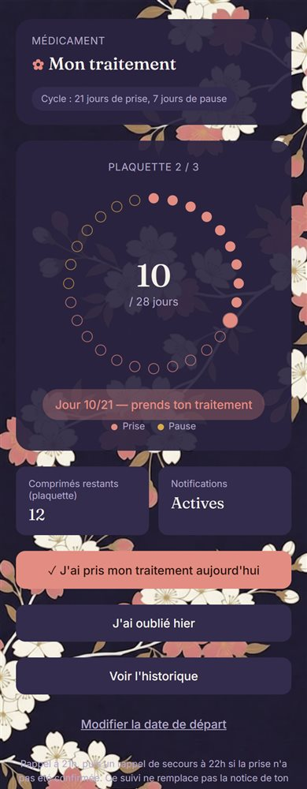
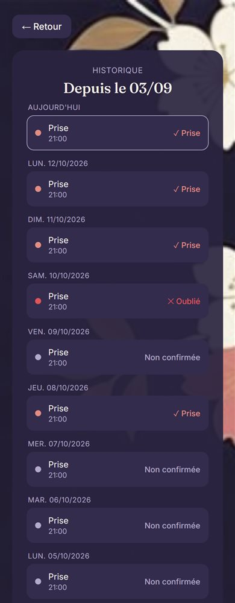
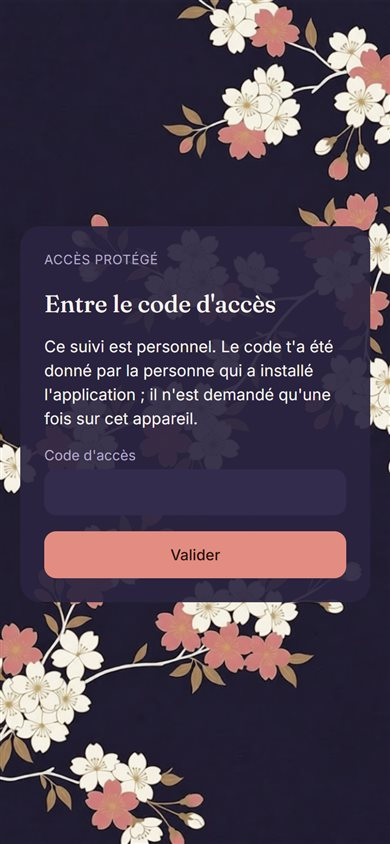

# Tracker

Une application web installable sur téléphone (PWA) pour suivre un traitement qui se prend par cycles, par exemple 21 jours de prise puis 7 jours de pause, et recevoir un rappel chaque soir.

Je l'ai écrite pour un proche qui ne trouvait pas d'application qui lui convenait, et elle sert tous les jours depuis l'été 2026.

<p>
  
  
  
</p>

## Ce que fait l'application

- Elle affiche où on en est : jour du cycle, plaquette en cours, comprimés restants, date de reprise pendant la pause.
- Elle envoie une notification chaque soir à heure fixe, même téléphone verrouillé.
- Elle envoie un rappel de secours une heure plus tard si la prise n'a pas été confirmée.
- Elle prévient qu'il faut racheter une boîte pendant la pause de la dernière plaquette.
- Elle garde l'historique des prises confirmées, des pauses et des oublis ; une prise ni confirmée ni signalée comme oubliée y apparaît comme « non confirmée ».

Le cycle, les heures de rappel et le nom du médicament se règlent par configuration. Par défaut, aucun nom de médicament n'apparaît nulle part.

## Comment c'est fait

```
Téléphone (PWA)  ──►  Fonctions serverless (Vercel)  ──►  Base de données (Supabase)
       ▲                        ▲
       │ notification push      │ appel à heure fixe
Service de push            cron-job.org
```

| Partie | Technologie |
|---|---|
| Interface | HTML, CSS et JavaScript sans framework, service worker |
| API | Fonctions Node.js sur Vercel, dans [api/](api) |
| Logique du cycle | Fonctions pures dans [lib/cycle.js](lib/cycle.js) |
| Données | Une table Supabase, décrite dans [supabase.sql](supabase.sql) |
| Notifications | Web Push (clés VAPID) |
| Déclenchement | cron-job.org, deux appels par jour |

## Les problèmes que j'ai dû résoudre

**Le rappel doit partir à 21h, été comme hiver.** Un cron se programme en heure fixe, alors que 21h à Paris correspond à 20h UTC en hiver et 19h UTC en été. Le serveur vérifie donc lui-même l'heure dans le fuseau configuré avant d'envoyer, et le jour courant est toujours calculé dans ce fuseau, jamais en UTC. Sans ça, une prise confirmée à minuit et demi serait rangée dans la veille.

**Un cron externe n'est pas ponctuel à la seconde.** Un appel arrivé à 20:59:58 était ignoré parce qu'il n'était « pas 21h », et aucun rappel ne partait ce soir-là. Le serveur accepte maintenant les cinq minutes qui précèdent l'heure visée.

**Le cron peut ne pas tourner pendant des semaines.** L'état du cycle n'est pas un compteur qu'on incrémente chaque jour : il est recalculé à partir de la date de début de la plaquette. Si plusieurs cycles ont passé, le calcul les rattrape d'un coup, changements de plaquette et de boîte compris.

**Les notifications sur iPhone.** Safari ne les autorise que pour une application installée sur l'écran d'accueil. L'application détecte ce cas et explique comment l'installer avant de demander l'autorisation.

**Un abonnement push peut mourir.** Quand le service de push répond que l'abonnement n'existe plus, il est retiré de la base et l'application redemande l'autorisation à la prochaine ouverture, au lieu d'envoyer dans le vide indéfiniment.

**Ce sont des données de santé.** L'API est fermée par un code d'accès demandé une fois par appareil, et les appels du cron par un secret distinct. Si l'un des deux n'est pas configuré, le serveur refuse de répondre plutôt que de rester ouvert. Les erreurs internes partent dans les journaux du serveur, pas dans les réponses.

## Tests

```bash
npm test
```

Les 60 tests tournent avec le lanceur intégré à Node, sans dépendance à installer. Ils couvrent :

- le cycle : changement de plaquette et de boîte, rattrapage après plusieurs cycles, autres durées (24/4, prise continue) ;
- les dates : fins de mois, 29 février, heure d'été, jour du changement d'heure ;
- l'API : contrôle d'accès, validation des entrées, envoi et non-envoi des rappels selon l'heure et l'état, abonnement expiré, pannes.

Les endpoints sont testés avec une base en mémoire et des notifications simulées ([scripts/fake-backend.js](scripts/fake-backend.js)).

## Lancer en local

```bash
npm run dev
```

L'application est servie sur http://localhost:3000 avec une base en mémoire ; le code d'accès est `dev`. Rien n'est lu ni écrit dans Supabase et aucune vraie notification ne part. `DEV_SEED=1 npm run dev` démarre avec un suivi déjà configuré.

## Déployer sa propre instance

Le guide pas à pas est dans [DEPLOY.md](DEPLOY.md) : base Supabase, clés VAPID, variables d'environnement Vercel et jobs cron.

## Limites

- L'application suit une seule personne par déploiement : une ligne en base, un code d'accès.
- Le code d'accès est un secret partagé, pas un compte utilisateur. Il n'y a pas de limite au nombre d'essais : il doit être long et aléatoire.
- C'est un outil de rappel. Il ne remplace ni la notice du médicament ni un avis médical.
